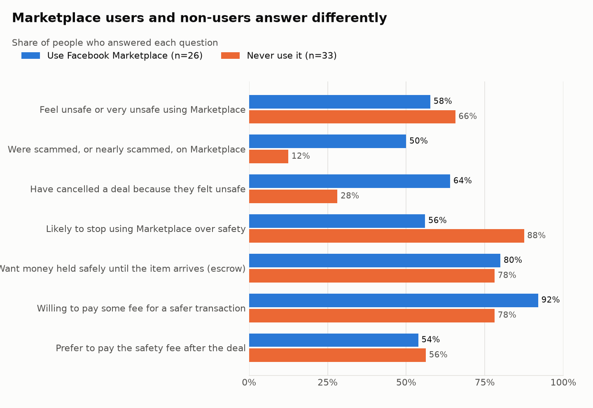
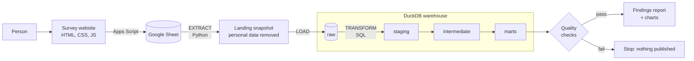
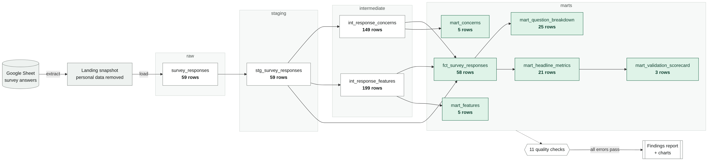

# SafeTrade

**Do people in South Africa want a safer way to buy and sell on Facebook Marketplace, and would they pay for it?**

SafeTrade started after a bad purchase of my own. Before building a payment platform, I tested the idea with data: a survey website to collect answers, and an **ELT data pipeline** that cleans, checks and analyses them, then scores the results against the success criteria in my [proposal](docs/FirstProposal.pdf).

**Live survey prototype:** https://safetradesa.netlify.app/
**Status:** paused (October 2026) · 58 responses · 2 of 3 success criteria met · decision: not moving forward for now ([findings and decision](docs/SafeTrade-Findings-and-Decision.pdf))

---

## What the data says



- **The problem is real for actual users.** Among people who use Facebook Marketplace, **50% were scammed or nearly scammed**, and **64% have cancelled a deal** because they felt unsafe.
- **People know what they want.** **80%** want their money held safely until the item arrives (escrow).
- **They would pay, but only a little.** 86% would pay some fee, but the most common choices are R5–R10 or a small percentage.
- **The survey reached the wrong people too.** 55% of respondents never use Facebook Marketplace. The pipeline caught this and now reports users and non-users separately.

Full results, made by the pipeline: [reports/findings.md](reports/findings.md)

| Proposal success criterion | Result (Marketplace users) | Status |
|---|---|---|
| 1. A majority are concerned about safety | 58% feel unsafe | Met |
| 2. A meaningful portion would pay | 92% would pay some fee | Met |
| 3. People click a "Pay securely" option | Not tested yet | Next step |

**Decision: not moving forward for now.** Under the proposal's framework the outcome is *Refine*: the results are mixed. The evidence rests on 26 Marketplace users whose answers were likely raised by the survey's story, the most common fee chosen (R5–R10) may not cover the cost of holding funds, and trust in a new platform was never tested. The project is paused, not closed: the [findings and decision report](docs/SafeTrade-Findings-and-Decision.pdf) sets out the conditions for revisiting it. The pipeline, data and documents are kept so work can resume without starting again.

---

## How it works



**The real tables, drawn from the code.** Every run reads the SQL files, works out which table feeds which, and redraws this map with the latest row counts ([reports/lineage.md](reports/lineage.md)). 59 responses go in; the fact table has 58 after one double submission is removed.



This is **ELT**: Extract the data, Load it raw into the warehouse, then Transform it with SQL inside the warehouse. Raw data is never changed, so any cleaning mistake can be fixed and re-run without collecting the survey again.

| Step | What happens | Code |
|---|---|---|
| Extract | Read the sheet, remove names and phone numbers, give each response a stable ID, save a snapshot | [`pipeline/extract.py`](pipeline/extract.py) |
| Load | Copy the snapshot into DuckDB as raw text, skipping responses already loaded | [`pipeline/load.py`](pipeline/load.py) |
| Transform | 8 SQL models in 3 layers: clean → reshape → answer questions | [`sql/`](sql/) |
| Check | 11 data quality checks; an error stops the run | [`sql/tests/`](sql/tests/) |
| Report | Findings page and charts, written from the marts | [`pipeline/report.py`](pipeline/report.py) |
| Lineage | Map of every table, what it reads, and its row count, drawn from the SQL | [`pipeline/lineage.py`](pipeline/lineage.py) |

---

## Run it

```bash
pip install -r requirements.txt
python -m pipeline.run          # runs on the anonymised sample in data/sample/
pytest -q                       # 21 tests
```

**Or with Docker** (no Python needed):

```bash
docker build -t safetrade .
docker run --rm -v "$(pwd)/reports:/app/reports" safetrade        # run the pipeline
docker run --rm safetrade pytest -q                               # run the tests
```

Takes under a second. To run it on the live sheet, see the [runbook](docs/4-runbook.md).

---

## Read more

| Doc | What's in it |
|---|---|
| [**Findings and decision (PDF)**](docs/SafeTrade-Findings-and-Decision.pdf) | What happened, what the data showed, and why SafeTrade is paused. LaTeX source in [`docs/final-report/`](docs/final-report/) |
| [**Validation study (PDF)**](docs/SafeTrade-Validation-Study.pdf) | The hypotheses, why this approach, how the survey questions were designed, results, and what the design got wrong |
| [1. Design](docs/1-design.md) | The problem, the rules I set, and why I chose each tool |
| [2. Build](docs/2-build.md) | How each step and each SQL layer works |
| [3. Testing](docs/3-testing.md) | Unit tests, data quality checks, and the bugs they caught |
| [4. Runbook](docs/4-runbook.md) | How to run, add a question, fix common problems, hand over |
| [5. Learnings](docs/5-learnings.md) | What went wrong, what I changed, what I'd do next time |
| [Data engineering concepts](docs/data-engineering-concepts.md) | ETL vs ELT, layers, idempotency, data quality, in plain words |
| [Data dictionary](docs/data-dictionary.md) | Every table and column |

---

## Folder guide

```text
safetrade/
├── app/frontend/          survey prototype (deployed on Netlify)
├── pipeline/              Python: extract, load, transform runner, checks, report
├── sql/
│   ├── staging/           clean one row per response
│   ├── intermediate/      split multi-choice answers into rows
│   ├── marts/             tables that answer the business questions
│   └── tests/             data quality checks
├── data/sample/           anonymised survey data (no names or phone numbers)
├── reports/               findings, charts and quality report (written by the pipeline)
├── tests/                 pytest tests with a made-up fixture
├── notebooks/             v1: the first cleaning notebook, kept to show the starting point
├── Dockerfile             runs the pipeline and tests in a container
└── docs/                  findings & decision (PDF + LaTeX), validation study (PDF), design, build, testing, runbook, learnings
```

## Privacy

Survey answers are personal data, protected by POPIA. Names, phone numbers and written stories are removed in the **first** step, before anything is saved. The raw sheet is private. The public sample uses only the multiple-choice answers.

---

Built by [Tshidiso Molefe](https://github.com/mlftsh030) · Tools: Python, pandas, DuckDB, SQL, pytest, matplotlib, Docker, Google Apps Script
