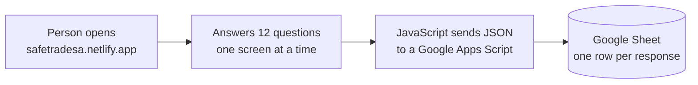

# 1. Design

**The pipeline exists to answer one business question with data I can trust: should SafeTrade go ahead, change direction, or stop?**

## The problem

People trade on Facebook Marketplace with no safe way to pay. Buyers send money and get nothing; sellers hand over items for fake proof of payment. My [proposal](FirstProposal.pdf) suggests an escrow service: the platform holds the money until the buyer confirms they got the item.

Before building that, the proposal sets three success criteria (section 6.4):

1. A majority of people are concerned about safety.
2. A meaningful portion would pay a small fee.
3. People actually click a "Pay securely" option when shown one.

The survey tests 1 and 2. The pipeline turns the answers into a clear yes or no for each.

## Where the data comes from

The sheet is the **source system**. It is easy to use and free, but it has the usual problems: free text, multi-choice answers squeezed into one cell, optional questions left blank, and personal data mixed in with the answers.

## The rules I set (design principles)

| # | Rule | Why |
|---|---|---|
| 1 | **Remove personal data first**, before anything is saved | Names and phone numbers were once committed to this public repo. Never again. Privacy is handled at the door, not at the end. |
| 2 | **Keep raw data unchanged** | If a cleaning rule is wrong, I fix the SQL and re-run. I never have to collect the survey again. |
| 3 | **Every run gives the same result** (idempotent) | Running it twice must not double the data. Each response gets an ID built from its answers, and the load skips IDs it already has. |
| 4 | **Clean in layers, each with one job** | Easier to find a bug: if a number is wrong, check marts, then intermediate, then staging. |
| 5 | **Check the data before publishing** | A wrong number in a report is worse than no report. An error-level check stops the run. |
| 6 | **Every number shows its denominator** | "79%" means nothing until you know "of whom". Every metric stores its numerator and denominator. |
| 7 | **Reports are written by code, never by hand** | If new answers arrive, re-run and every number and chart updates. |

## Why ELT and not ETL

| | ETL | ELT (what I used) |
|---|---|---|
| Order | Extract → Transform → Load | Extract → Load → Transform |
| Where cleaning happens | In Python, before the warehouse | In SQL, inside the warehouse |
| If a cleaning rule is wrong | Re-extract from the source | Re-run the SQL on raw data already stored |
| Who can read the logic | Python developers | Anyone who knows SQL, including analysts |

My first version (the notebook in `notebooks/`) was really ETL in one script: read, clean in pandas, save a file. When I found bugs in the cleaning, the only fix was to re-run everything from the sheet. ELT separates "getting the data" from "making sense of it". I kept one ETL-style step on purpose: **personal data is removed during extract**, because it should never be stored at all.

More on these ideas: [data engineering concepts](data-engineering-concepts.md).

## Tool choices

| Need | Choice | Why this and not something bigger |
|---|---|---|
| Warehouse | **DuckDB** | A full analytical database in one file. No server, free, runs on a laptop and in CI. Same SQL ideas as Snowflake or BigQuery, at the right size for 59 rows. |
| Transform | **Plain SQL files** run in order | Same layered idea as dbt, without the setup. Moving to dbt later is mostly renaming files. |
| Extract and orchestration | **Python** | Reading a CSV from a URL and running steps in order needs no scheduler yet. |
| Tests | **pytest** + SQL checks | pytest tests the code; SQL checks test the data. Both are needed. |
| Charts | **matplotlib** | Charts are saved as images so they show on GitHub. |
| Packaging | **Docker** | Anyone can run the pipeline and tests with one command, without installing Python or packages. Same idea I used to deploy SL Tours. |

## What it does not do yet

- It runs when I start it. There is no schedule (see [learnings](5-learnings.md) for what I'd add).
- It does not measure criterion 3. That needs a demand-test page that records clicks.
- 58 responses is a small sample. The pipeline is built to handle more without changes.
