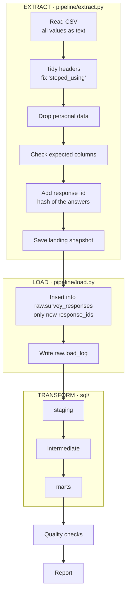

# 2. Build

**How each step works, and what each SQL layer is responsible for.**



## Extract

| What | How | Why |
|---|---|---|
| Read the source | `pd.read_csv(..., dtype=str)` from the sheet's CSV link or a local file | Reading everything as text stops pandas from guessing types. The first notebook turned phone numbers into scientific notation this way. |
| Tidy headers | strip, lowercase, spaces → `_`, fix the misspelt `stoped_using` | Every later step can rely on the same names. |
| Drop personal data | removes `name`, `phone`, `email`, `scam_story`, `trust_insight` | Design rule 1. |
| Schema check | stop with a clear error if an expected column is missing | If someone renames a survey question, the run fails loudly instead of giving wrong numbers. |
| Response ID | first 16 characters of a SHA-256 hash of all answers | The same submission always gets the same ID, so re-runs can spot it. |
| Landing snapshot | `data/landing/responses_<batch_id>.csv` | A record of exactly what was received on each run. |

## Load

The snapshot is copied into `raw.survey_responses` in DuckDB with three extra columns: `_batch_id`, `_loaded_at`, `_source`. Only rows whose `response_id` isn't already there are inserted. Each run adds a row to `raw.load_log` (rows in file, rows inserted), so you can see what every run did.

Run it twice and the second run inserts 0 rows. That is **idempotency**, and there's a test for it.

## Transform: three SQL layers

| Layer | Job | Models |
|---|---|---|
| **staging** | Clean one row per response: trim, fix types, map free text to fixed categories, flag double submissions | `stg_survey_responses` |
| **intermediate** | Reshape: split multi-choice cells into one row per choice | `int_response_concerns`, `int_response_features` |
| **marts** | Answer business questions: one wide table for analysis, plus summary tables | `fct_survey_responses`, `mart_question_breakdown`, `mart_concerns`, `mart_features`, `mart_headline_metrics`, `mart_validation_scorecard` |

Data only flows forward: a model reads tables from its own layer or an earlier one, never a later one. Files run in name order, so `01_` runs before `02_`. Before transforming, the pipeline checks this order from the SQL itself and stops if a model reads a table that isn't built yet.

The full, always-current picture is drawn on every run: [reports/lineage.md](../reports/lineage.md).

### Staging: mapping text to categories

Answers are matched by **pattern**, not exact text:

```sql
CASE
    WHEN scam_txt LIKE 'yes%'       THEN 'scammed'
    WHEN scam_txt LIKE 'almost%'    THEN 'almost_scammed'
    WHEN scam_txt LIKE 'no, but%'   THEN 'worried_not_scammed'
    WHEN scam_txt LIKE 'no, never%' THEN 'never_scammed'
    ELSE 'unmapped'
END
```

Anything that doesn't match becomes `'unmapped'`, and a quality check fails the run if any `'unmapped'` appears. So a new or changed answer can never slip through silently.

### Staging: catching double submissions

The response ID includes the timestamp, so the same answers sent twice (a double tap on Submit) get two different IDs and both load. Staging builds a second fingerprint from the **answers only**, and flags a response if identical answers arrived in the 2 minutes before:

```sql
coalesce(
    submitted_at - lag(submitted_at) OVER (
        PARTITION BY answers_fingerprint ORDER BY submitted_at
    ) <= INTERVAL 2 MINUTE,
    false
) AS is_double_submission
```

Staging keeps every row (so it still matches raw). From the intermediate layer onwards, flagged rows are left out. In the real data, 1 response was a repeat sent 14 seconds after the first.

### Intermediate: splitting multi-choice answers

A cell like `"Fake sellers / listings, Payment fraud (fake proof of payment)"` becomes two rows:

| response_id | concern |
|---|---|
| a1b2… | fake_sellers |
| a1b2… | payment_fraud |

```sql
SELECT response_id, trim(unnest(string_split(top_concerns_raw, ','))) AS concern_label
FROM staging.stg_survey_responses
```

The first notebook made one hard-coded column per option and missed two of them ("no recourse" and two wanted features). In long format, every option is counted automatically.

### Marts: answering the questions

- **`fct_survey_responses`**: one row per response, every answer as a clean column, a 0/1 flag per concern and feature, and a `segment` (Marketplace user or not). This is what you'd connect Power BI or Tableau to.
- **`mart_headline_metrics`**: the key numbers for three segments (all, Marketplace users, non-users), each with numerator and denominator.
- **`mart_validation_scorecard`**: scores the proposal's success criteria. Status is judged on Marketplace users, because they are the target market.

## Quality checks and report

After transform, the 11 checks in `sql/tests/` run (see [testing](3-testing.md)). If none fail at error level, `pipeline/report.py` writes `reports/findings.md` and four charts from the marts.

## Run log example

```text
EXTRACT    59 responses -> data/landing/responses_20261013T173244693017Z.csv (personal data removed)
LOAD       59 new, 0 already loaded, 59 in raw
TRANSFORM  built 8 models
WARNING    CHECK 08_skipped_key_questions: 2 rows flagged
WARNING    CHECK 09_non_users_in_sample: 32 rows flagged
WARNING    CHECK 11_double_submissions: 1 rows flagged
CHECKS     8 of 11 passed
REPORT     reports/findings.md
Done in 0.5s
```
