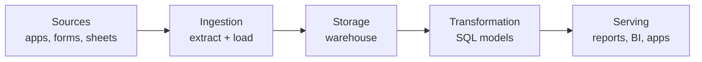

# Data engineering concepts, using this project

**Each idea in plain words, then where it shows up in SafeTrade.** Useful for anyone reading the code, and for me in interviews.

## The big picture

Data engineering is building the **pipes** that move data from where it's created to where it's used, so it arrives **clean, correct, on time, and safe**. Analysis asks "what does the data say?" Engineering makes sure the answer can be trusted and repeated.

## ETL vs ELT

- **ETL (Extract → Transform → Load):** clean the data first, then store only the clean result. Common when storage was expensive.
- **ELT (Extract → Load → Transform):** store the raw data first, then clean it with SQL inside the warehouse. Common now, because storage is cheap and warehouses are fast.

**Pattern:** ELT keeps the original. If you find a mistake later, you fix the SQL and rebuild, instead of going back to the source.
**Here:** `pipeline/extract.py` and `pipeline/load.py` store raw text; `sql/` does all the cleaning. The one exception is personal data, which is removed during extract on purpose.

## Layers (staging → intermediate → marts)

Also called bronze → silver → gold, or the "medallion" pattern.

| Layer | Job | Rule |
|---|---|---|
| raw | Exactly what was received | Never edited |
| staging | Clean, typed, one row per thing | Light changes only, no joins |
| intermediate | Reshape and combine | Building blocks, not for end users |
| marts | Answer business questions | What reports and BI tools read |

**Pattern:** each layer does one job, so when a number is wrong you know where to look.
**Here:** `sql/staging/`, `sql/intermediate/`, `sql/marts/`.

## Landing zone

A place where incoming files are saved exactly as received, before loading.
**Here:** `data/landing/responses_<batch_id>.csv`, one per run.

## Idempotency

Running a step twice gives the same result as running it once.
**Why it matters:** pipelines get re-run all the time (a failure, a retry, a scheduler firing twice). Without idempotency, every re-run doubles your data.
**Here:** every response gets an ID from a hash of its answers; the load only inserts IDs it hasn't seen. Run it twice: `LOAD 0 new`.

## Deduplication

Idempotency stops the *pipeline* from creating duplicates. **Deduplication** removes duplicates that came from the *source*, like someone tapping Submit twice. The hard part is defining "the same": here it's identical answers within 2 minutes.
**Here:** `is_double_submission` in staging, check 11.

## Natural key vs surrogate key

- A **natural key** comes from the data itself (an ID number, an email).
- A **surrogate key** is made up by the system.

**Here:** the survey has no ID, so `response_id` is a hash of the answers: a key built from the data, stable across runs.

## Schema

The expected shape of the data: column names and types.
- **Schema-on-read:** store everything as text, decide types later (raw layer).
- **Schema check:** stop if the source shape changes ("schema drift").

**Here:** raw is all `VARCHAR`; staging sets types; extract stops if a column is missing.

## Data quality

Rules the data must follow, checked on every run. The common types:

| Type | Question | Check here |
|---|---|---|
| Uniqueness | Is anything duplicated? | 01, 11 |
| Completeness | Is anything missing that must be there? | 02, 06, 08 |
| Validity | Are values in the allowed set or range? | 04, 05, 10 |
| Consistency | Do layers agree with each other? | 03 |
| Representativeness | Is the data about the right people? | 09 |

**Pattern:** fail loudly on errors, report warnings. Never publish numbers from data that failed.

## Long vs wide format

- **Wide:** one row per response, one column per option (`concern_fake_sellers`, `concern_payment_fraud`, ...).
- **Long:** one row per (response, option).

**Pattern:** long is better for storing and counting (new options appear automatically); wide is better for a final analysis table.
**Here:** `intermediate/` is long; `fct_survey_responses` turns it back into wide flags.

## Fact tables and marts

A **fact table** records events or things that happened, one row each, with measures and flags. A **mart** is a table built to answer a specific question for a specific user.
**Here:** `fct_survey_responses` (one row per response) and the `mart_*` tables.

## Lineage

Knowing where every number came from.
**Here:** each metric in `mart_headline_metrics` stores its numerator and denominator; each raw row has `_batch_id`, `_loaded_at`, `_source`; `raw.load_log` records every run.

**Here too:** `pipeline/lineage.py` reads the SQL files, finds which tables each model reads, and draws the whole pipeline with row counts on every run ([reports/lineage.md](../reports/lineage.md)). Tools like dbt and Dagster draw the same kind of graph. Because it comes from the code, it can't go out of date. The same parse also checks the run order: a model can't read a table that hasn't been built yet. In a real data team this is called a **DAG** (directed acyclic graph): steps with arrows that only go forward.

## PII and data privacy

**PII** is personally identifiable information: names, phone numbers, emails, ID numbers. South Africa's **POPIA** law says it must be protected.
**Pattern:** collect as little as possible, remove it as early as possible, and never put it in a public place.
**Here:** `PII_COLUMNS` in `pipeline/config.py`, dropped in extract.

## Orchestration (next step)

A tool that runs pipeline steps in order, on a schedule, with retries and alerts (Airflow, Dagster, Prefect, or simply GitHub Actions).
**Here now:** `pipeline/run.py` runs the steps in order and stops on failure. A schedule is the next step.

## Words you'll hear, mapped to this project

| Term | Here |
|---|---|
| Ingestion | extract + load |
| Warehouse | DuckDB file `data/warehouse/safetrade.duckdb` |
| Model | one SQL file that builds one table |
| dbt | a tool for running SQL models in layers with tests; this project uses the same idea with plain SQL |
| Batch | one run; `_batch_id` |
| Backfill | re-running for old data; easy here because raw is kept |
| Data contract | the agreed columns and allowed values; `EXPECTED_COLUMNS` + the staging mappings |
