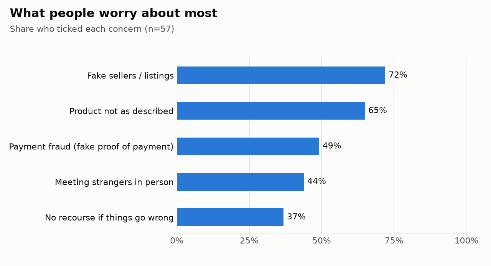
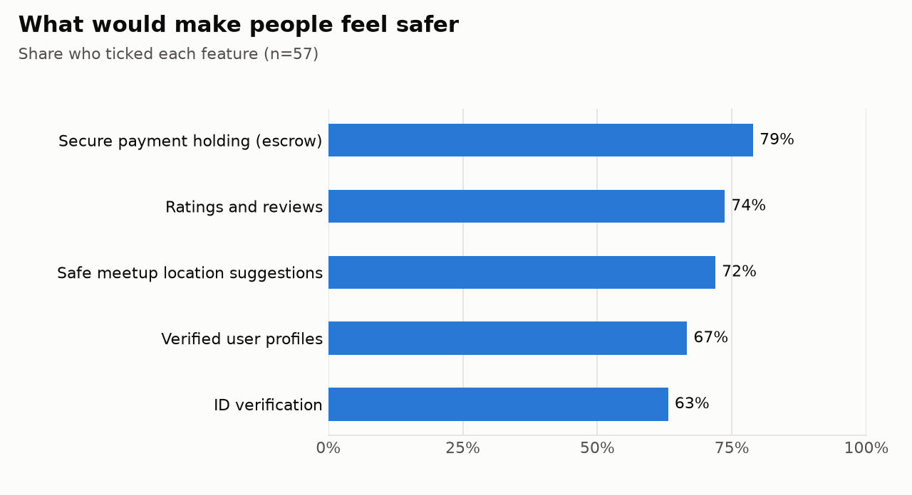
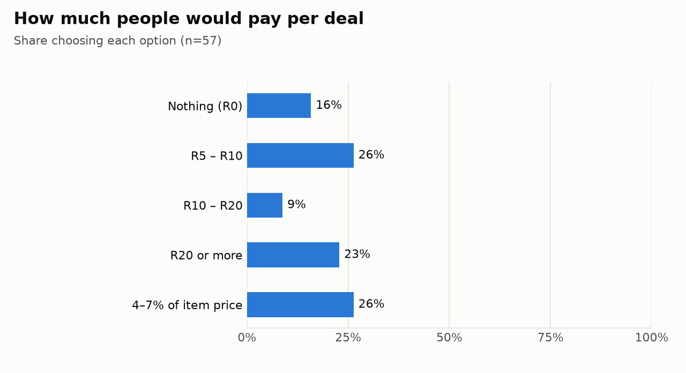

# SafeTrade findings

_Written by the pipeline from the marts. Do not edit by hand; run `python -m pipeline.run`._

**Responses:** 59 (59 received, 0 double submission left out) · Percentages use the people who answered each question.

## Key numbers

| Finding | All | Marketplace users | Never use Marketplace |
|---|---|---|---|
| Feel unsafe or very unsafe using Marketplace | 62% | 58% | 66% |
| Were scammed, or nearly scammed, on Marketplace | 29% | 50% | 12% |
| Have cancelled a deal because they felt unsafe | 44% | 64% | 28% |
| Likely to stop using Marketplace over safety | 74% | 56% | 88% |
| Want money held safely until the item arrives (escrow) | 79% | 80% | 78% |
| Willing to pay some fee for a safer transaction | 84% | 92% | 78% |
| Prefer to pay the safety fee after the deal | 55% | 54% | 56% |

## Proposal success criteria

| # | Criterion | Marketplace users | All | Bar | Status |
|---|---|---|---|---|---|
| 1 | A majority are concerned about transaction safety | 58% | 62% | 50% | met |
| 2 | A meaningful portion are willing to pay (threshold is our assumption) | 92% | 84% | 50% | met |
| 3 | Observable interest in a "Pay securely" option (clicks, sign-ups) | – | – | – | not measured yet |

## Concerns

## Wanted features

## Fees

Data quality for this run: see [quality_report.md](quality_report.md).
