# Pipeline lineage

_Drawn by `pipeline/lineage.py` from the SQL files, with row counts from the latest run. Do not edit by hand._

```mermaid
flowchart LR
    sheet[("Google Sheet<br/>survey answers")]
    landing["Landing snapshot<br/>personal data removed"]
    sheet -->|extract| landing
    subgraph raw["raw"]
        raw__survey_responses["survey_responses<br/><b>59 rows</b>"]
    end
    subgraph staging["staging"]
        staging__stg_survey_responses["stg_survey_responses<br/><b>59 rows</b>"]
    end
    subgraph intermediate["intermediate"]
        intermediate__int_response_concerns["int_response_concerns<br/><b>152 rows</b>"]
        intermediate__int_response_features["int_response_features<br/><b>202 rows</b>"]
    end
    subgraph marts["marts"]
        marts__fct_survey_responses["fct_survey_responses<br/><b>59 rows</b>"]
        marts__mart_concerns["mart_concerns<br/><b>5 rows</b>"]
        marts__mart_features["mart_features<br/><b>5 rows</b>"]
        marts__mart_headline_metrics["mart_headline_metrics<br/><b>21 rows</b>"]
        marts__mart_question_breakdown["mart_question_breakdown<br/><b>25 rows</b>"]
        marts__mart_validation_scorecard["mart_validation_scorecard<br/><b>3 rows</b>"]
    end
    landing -->|load| raw__survey_responses
    raw__survey_responses --> staging__stg_survey_responses
    staging__stg_survey_responses --> intermediate__int_response_concerns
    staging__stg_survey_responses --> intermediate__int_response_features
    intermediate__int_response_concerns --> marts__fct_survey_responses
    intermediate__int_response_features --> marts__fct_survey_responses
    staging__stg_survey_responses --> marts__fct_survey_responses
    marts__fct_survey_responses --> marts__mart_question_breakdown
    intermediate__int_response_concerns --> marts__mart_concerns
    intermediate__int_response_features --> marts__mart_features
    marts__fct_survey_responses --> marts__mart_headline_metrics
    marts__mart_headline_metrics --> marts__mart_validation_scorecard
    checks{{"10 quality checks"}}
    marts -.-> checks
    report[["Findings report<br/>+ charts"]]
    checks -->|all errors pass| report
    style raw fill:#f7f9f8,stroke:#cfd6d2,color:#4a514e
    style staging fill:#f7f9f8,stroke:#cfd6d2,color:#4a514e
    style intermediate fill:#f7f9f8,stroke:#cfd6d2,color:#4a514e
    style marts fill:#f7f9f8,stroke:#cfd6d2,color:#4a514e
    classDef default fill:#ffffff,stroke:#7a807d,color:#111514
    classDef src fill:#eef2f0,stroke:#7a807d,color:#111514
    classDef mart fill:#dff3e8,stroke:#0b5a3a,color:#0b3d2c
    class sheet,landing src
    class marts__fct_survey_responses,marts__mart_concerns,marts__mart_features,marts__mart_headline_metrics,marts__mart_question_breakdown,marts__mart_validation_scorecard mart
```

Arrows show which table each model reads. Data only flows forward: every model reads tables from its own layer or an earlier one, built before it runs (the pipeline checks this before transforming).

| Table | Built by | Reads from | Rows |
|---|---|---|---|
| raw.survey_responses | `pipeline/load.py` | landing snapshot | 59 |
| staging.stg_survey_responses | `sql/staging/01_stg_survey_responses.sql` | raw.survey_responses | 59 |
| intermediate.int_response_concerns | `sql/intermediate/01_int_response_concerns.sql` | staging.stg_survey_responses | 152 |
| intermediate.int_response_features | `sql/intermediate/02_int_response_features.sql` | staging.stg_survey_responses | 202 |
| marts.fct_survey_responses | `sql/marts/01_fct_survey_responses.sql` | intermediate.int_response_concerns, intermediate.int_response_features, staging.stg_survey_responses | 59 |
| marts.mart_question_breakdown | `sql/marts/02_mart_question_breakdown.sql` | marts.fct_survey_responses | 25 |
| marts.mart_concerns | `sql/marts/03_mart_concerns_and_features.sql` | intermediate.int_response_concerns | 5 |
| marts.mart_features | `sql/marts/03_mart_concerns_and_features.sql` | intermediate.int_response_features | 5 |
| marts.mart_headline_metrics | `sql/marts/04_mart_headline_metrics.sql` | marts.fct_survey_responses | 21 |
| marts.mart_validation_scorecard | `sql/marts/05_mart_validation_scorecard.sql` | marts.mart_headline_metrics | 3 |
